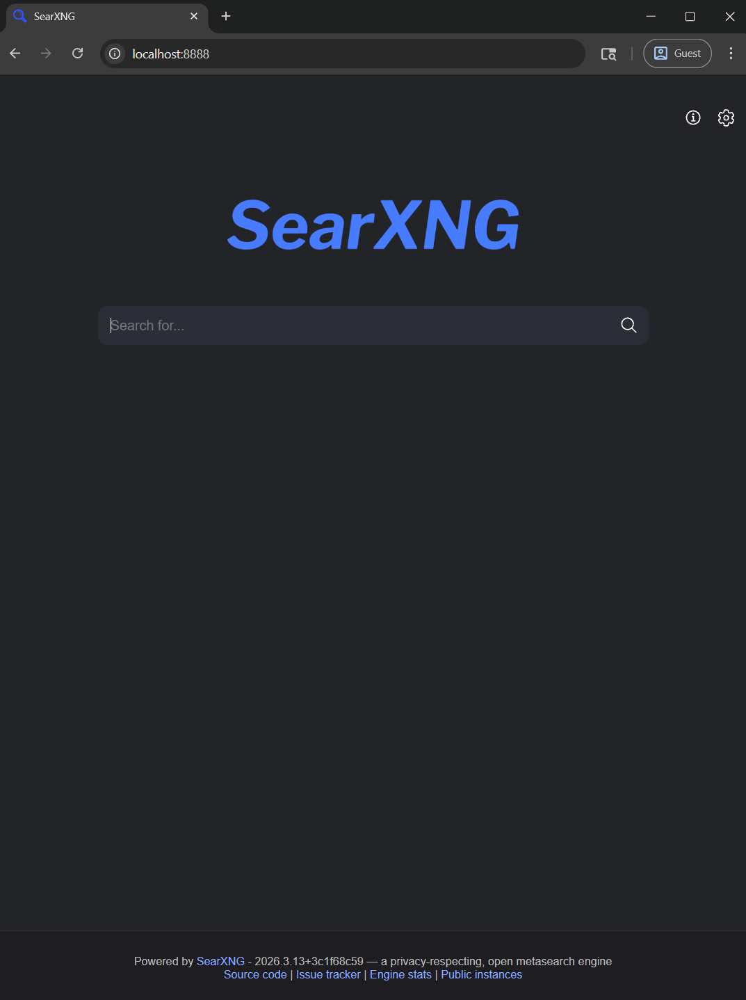
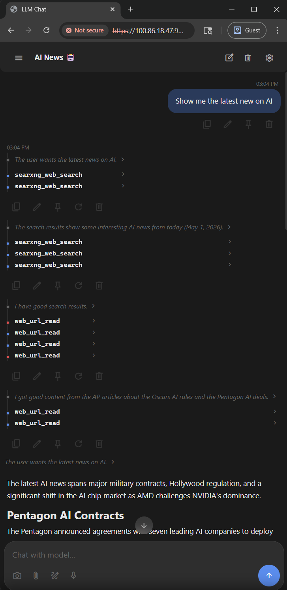
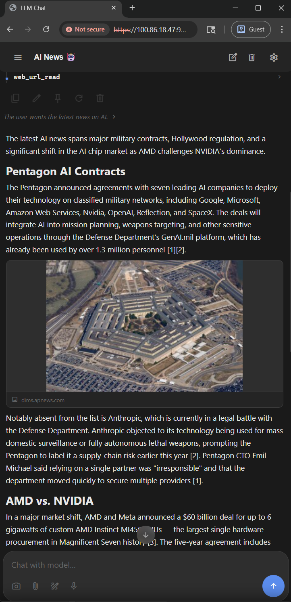
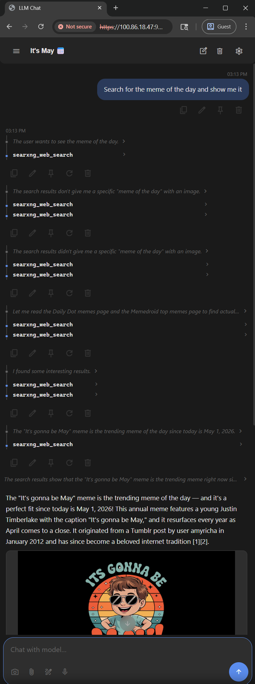
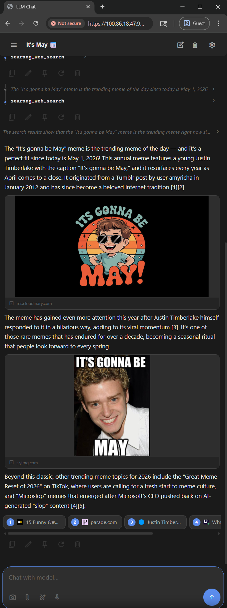

# WebSearch SearXNG + MCP Server

A self-hosted SearXNG metasearch engine paired with the `mcp-searxng` MCP server, **built for LLMs, agents, and tool-using applications**. Lets your model (or autonomous agent) browse the web, run searches across many engines at once, and surface images directly in your front end. Runs entirely on your own machine via Docker, accessed from your browser, and speaks MCP over HTTP Streamable transport so it plugs into any MCP-compatible client (Claude Desktop, Cline, Open WebUI, LM Studio, custom agent frameworks, etc.). Enhanced with image/video/category search, offset pagination, and smart base64 image resizing for vision-capable models. Both services stay on your local network, so nothing leaves your box unless you ask it to. **No ads, no telemetry, no third-party trackers, no accounts** — the SearXNG frontend is privacy-by-design and the MCP patches add zero phone-home of their own.

<table cellspacing="0" cellpadding="0" border="0">
  <tr>
    <td align="center" valign="top" width="280">
      <a href="assets/searxng-frontend.png">
        
      </a>
      <br>
      <sub><b>SearXNG frontend</b> — the privacy-respecting metasearch UI at <code>localhost:8888</code>. Same backend the MCP server queries internally.</sub>
    </td>
    <td width="20"></td>
    <td align="center" valign="top" width="280">
      <a href="assets/llm-tool-chain.png">
        
      </a>
      <br>
      <sub><b>Autonomous tool chain</b> — model fires multiple <code>searxng_web_search</code> calls in parallel, then chains into <code>web_url_read</code> to pull full article text.</sub>
    </td>
    <td width="20"></td>
    <td align="center" valign="top" width="280">
      <a href="assets/text-extraction.png">
        
      </a>
      <br>
      <sub><b>Clean text extraction</b> — long-form article content pulled by <code>web_url_read</code>, boilerplate stripped, ready for the model to summarize.</sub>
    </td>
  </tr>
</table>

<br><br>

<table cellspacing="0" cellpadding="0" border="0">
  <tr>
    <td align="center" valign="top" width="280">
      <a href="assets/inline-news-image.png">
        
      </a>
      <br>
      <sub><b>Inline image in news briefing</b> — image fetched and resized through <code>web_url_read</code>'s <code>sharp</code> pipeline. No external CDN, served as a base64 MCP image block.</sub>
    </td>
    <td width="20"></td>
    <td align="center" valign="top" width="280">
      <a href="assets/meme-multi-query.png">
        
      </a>
      <br>
      <sub><b>Multi-query parallel search</b> — queries separated by <code> | </code> fan out several <code>searxng_web_search</code> calls at once, landing on the "It's Gonna Be May" meme.</sub>
    </td>
    <td width="20"></td>
    <td align="center" valign="top" width="280">
      <a href="assets/meme-images-inline.png">
        
      </a>
      <br>
      <sub><b>Native image blocks</b> — multiple images returned inline. The <code>detail</code> parameter (<code>low</code>/<code>medium</code>/<code>high</code>) controls resize quality vs. token cost.</sub>
    </td>
  </tr>
</table>

## Installation

> **Quick note on privacy before you start.** This stack runs entirely on your machine and is privacy-respecting by design (no telemetry, no accounts, no third-party trackers), but the defaults are tuned for "just works," not maximum privacy. Before exposing it beyond your own computer, to your LAN, the internet, or anyone else please read **[ADVANCED.md](ADVANCED.md)**

### Prerequisites
- Docker and Docker Compose must be installed (Node.js is **not** needed on the host: the MCP server runs inside its Docker image)

### Step 1: Clone the Repository

```bash
git clone https://github.com/hypersniper05/MCP-WebSearch-SearXNG.git
cd MCP-WebSearch-SearXNG
```

This gives you the `docker-compose.yml`, the SearXNG `settings.yml`, the MCP patches, and the custom `Dockerfile` already laid out — so the next step is straight to configuration.

> Prefer to set everything up by hand instead of cloning? See [**Building from scratch (without cloning)**](ADVANCED.md#building-from-scratch-without-cloning) in ADVANCED.md.

### Step 2: Configure SearXNG Settings

The shipped `searxng/config/settings.yml` is **already preconfigured** for this stack — JSON output enabled, rate limiter off, a curated set of engines that answer self-hosted instances, and long engine suspension times so a blocked engine is not retried on every single query. It only holds overrides: SearXNG merges it over the default settings inside the (pinned) image. The only thing you need to set is the secret key.

> Want to change which engines are enabled, the request timeout, or any other SearXNG default? See [**Modifying the default settings**](ADVANCED.md#modifying-the-default-settings) in ADVANCED.md.

#### Set the `secret_key` (or use the env var)

SearXNG **will start** without a key, so for a localhost-only personal instance you can come back to this later. **But** if you ever bind to `0.0.0.0`, expose this to your LAN, or share it with anyone, set a real one — otherwise anyone can forge the HMAC that SearXNG's `/image_proxy` endpoint checks and use your instance as an open image proxy.

Set it in a `.env` file next to `docker-compose.yml`:
```
SEARXNG_SECRET=<paste your generated 64-char hex string here>
```

`docker-compose.yml` always passes `SEARXNG_SECRET` into the container, and SearXNG lets that variable override `settings.yml` **even when it is empty**. So the `secret_key: "CHANGE_ME_BEFORE_RUNNING"` placeholder in `settings.yml` is never used, and editing it has no effect — without a `.env` value the instance runs with an empty key. Use `.env` (it is gitignored, so the key never reaches the repo).

**Generate a key with whichever tool you have installed:**
```powershell
# PowerShell (Windows PowerShell 5.1 and PowerShell 7 — built in)
$b = New-Object byte[] 32; [System.Security.Cryptography.RandomNumberGenerator]::Create().GetBytes($b); -join ($b | ForEach-Object { $_.ToString('x2') })
```
```bash
# Node.js (if you have it)
node -e "console.log(require('crypto').randomBytes(32).toString('hex'))"

# Docker (works anywhere this stack does)
docker run --rm alpine sh -c "apk add --no-cache openssl > /dev/null && openssl rand -hex 32"

# Git Bash / Linux / macOS
openssl rand -hex 32

# Python
python -c "import secrets; print(secrets.token_hex(32))"
```

For the rest of the privacy/hardening trade-offs (LAN exposure, MCP auth, Tor routing), see **[ADVANCED.md](ADVANCED.md)**.

### Step 3: Build and Start Everything

```bash
docker compose build
docker compose up -d
```

### Step 4: Verify Services

Health check:
```bash
curl -s http://localhost:3001/health
```

Expected: `{"status":"healthy","server":"ihor-sokoliuk/mcp-searxng","version":"2.4.0-enhanced","transport":"http"}`

Test search:
```bash
curl -s "http://localhost:8888/search?q=test&format=json" | head -c 200
```

### Step 5 (only if accessing from another machine): Open the bindings to your LAN / Tailscale

By default the shipped `docker-compose.yml` binds SearXNG to **`127.0.0.1`** (this machine only) and the MCP server to **`0.0.0.0`** (already reachable from your LAN / Tailscale tailnet). Both come from `.env`: `SEARXNG_BIND` (default `127.0.0.1`) and `MCP_BIND` (default `0.0.0.0`).

Quick diagnostic to spot this:

```cmd
docker compose ps
```

Look at the **PORTS** column. If you see:

| What you see | What it means |
|---|---|
| `0.0.0.0:8888->8080/tcp` | Reachable from anywhere on the network ✓ |
| `127.0.0.1:8888->8080/tcp` | **Localhost only** — the *exact* symptom that makes external access "time out" |

If a row shows `127.0.0.1:` and you need it reachable off-host, set the binding in `.env` (next to `docker-compose.yml`). Do not edit `docker-compose.yml` itself: `.env` is gitignored, so `git pull` never conflicts with your choice.

```
SEARXNG_BIND=0.0.0.0   # default 127.0.0.1
MCP_BIND=0.0.0.0       # already the default; 127.0.0.1 keeps the MCP endpoint on this machine
```

Then recreate the containers (port changes don't apply on a plain `restart`):

```cmd
docker compose down
docker compose up -d
docker compose ps
```

The changed rows should now show `0.0.0.0:...`.

If `docker compose ps` already shows `0.0.0.0` and external access *still* fails, it's the OS firewall. On Windows, allow the ports from an admin PowerShell:

```powershell
New-NetFirewallRule -DisplayName "MCP SearXNG (8888)" -Direction Inbound -Protocol TCP -LocalPort 8888 -Action Allow
New-NetFirewallRule -DisplayName "MCP Server (3001)"   -Direction Inbound -Protocol TCP -LocalPort 3001 -Action Allow
```

**Browser-based MCP clients** (anything that sends an `Origin` header, such as a web UI or the MCP Inspector) are refused with HTTP 403 unless their origin is listed. Add the exact origins, with scheme and port, to `.env`, e.g. `MCP_ALLOWED_ORIGINS=http://localhost:3001,http://100.x.y.z:3001`. The list replaces the localhost default, so include those too if you need them. Clients that send no `Origin` (Claude Code, SDK clients, LM Studio, curl) are not affected.

> **Security note**: `0.0.0.0` exposes a service to anyone who can reach your machine on that port, and the MCP server is bound to `0.0.0.0` by default (set `MCP_BIND=127.0.0.1` in `.env` to keep it local). The MCP server has no authentication by default. Upstream can require a static bearer token in its hardened mode, or OAuth access tokens; if you're going beyond a trusted home/Tailscale network, read [ADVANCED.md → Tier 2](ADVANCED.md#tier-2--network-hardening).

## Endpoints Summary

| Service     | URL                          | Purpose                    |
|-------------|------------------------------|----------------------------|
| SearXNG UI  | http://localhost:8888        | Web search interface       |
| SearXNG API | http://localhost:8888/search | JSON search API            |
| MCP Server  | http://localhost:3001/mcp    | MCP Streamable HTTP        |
| MCP Health  | http://localhost:3001/health | Health check endpoint      |

> Need TLS for an HTTPS-only client? The cleanest path is **[Tailscale Serve](https://tailscale.com/kb/1242/tailscale-serve/)** if both ends are on a tailnet (real Let's Encrypt-trusted cert, zero per-client setup), or a reverse proxy like Caddy / nginx with your own cert otherwise. Either is added in front of the existing HTTP MCP endpoint without any changes to this stack.

## MCP Tools

### 1. searxng_web_search
Web search with category, pagination, and filtering support. Returns structured JSON: `results` (title, url, description, published date, source `engines`, `score`), `suggestions`, `corrections`, `answers`, `infoboxes`, `unresponsive_engines`, `engine_coverage` (`answered` engines and `failed_count`) and `pagination`.

Separate queries with ` | ` to run several searches in one call (`"CFM LEAP engine | A320neo sharklet"`) -- up to 10, two at a time.

| Parameter    | Type   | Description |
|-------------|--------|-------------|
| `query`      | string | Search query (required). Operators: `"exact phrase"`, `site:`, `filetype:`, `+required -excluded`, `OR` |
| `categories` | string | `general` (default), `images`, `videos`, `news`, `science`, `music`, `files` (torrents), `it` (developer/IT sites), `social media`; comma-separated for several |
| `max_results`| number | Results per call, 1-50 (default: 20 general/news, 10 images/videos) |
| `offset`     | number | Skip N results for pagination (e.g., 10 for results 11-20) |
| `pageno`     | number | SearXNG page number (a new batch from the engines) |
| `time_range` | string | `day`, `week`, `month`, `year` |
| `language`   | string | Language code (e.g., `en`, `fr`); `all` = no filter (default) |
| `safesearch` | number | `0` (none, default), `1` (moderate), `2` (strict) |
| `engines`    | string | Comma-separated engine names to use instead of the category's engines (e.g. `bing,yahoo`) |
| `min_score`  | number | Drop results below this relevance score (0.0-1.0) |

Optional arguments may be `null` or `""`; they are treated as not set.

### 2. web_url_read
Reads web pages (as markdown), PDFs (up to 16 MB), and images. Image URLs are detected automatically and returned as resized base64 image blocks.

| Parameter      | Type    | Description |
|---------------|---------|-------------|
| `url`          | string  | URL to read (required) |
| `detail`       | string  | Image resize level: `low` (448px, ~256 tokens), `medium` (768px, ~756 tokens, default), `high` (1280px, ~2048 tokens) |
| `startChar`    | number  | Character offset for text pagination |
| `maxLength`    | number  | Max characters to return |
| `section`      | string  | Extract content under a heading |
| `paragraphRange`| string | Paragraph range (e.g., `1-5`) |
| `readHeadings` | boolean | Return headings only |

`web_url_read` refuses private addresses -- localhost, LAN (RFC1918), Tailscale (100.64.0.0/10), link-local, and Docker hostnames -- on the first request and on every redirect. Set `MCP_HTTP_ALLOW_PRIVATE_URLS=true` on the `mcp-searxng` service only if you want it to read internal services.

### 3. searxng_instance_info and searxng_search_suggestions
From upstream. `searxng_instance_info` lists the instance's categories and engines. `searxng_search_suggestions` returns no query suggestions here, because autocomplete is off in `settings.yml` (the web UI would otherwise send every keystroke to a third-party suggestion service). It only completes SearXNG `!bang` prefixes, e.g. `!bi` → `!bing`.

## Image Search Flow
1. `searxng_web_search({query: "sunset", categories: "images"})` -> returns image URLs + metadata
2. Pick an image -> `web_url_read({url: "https://example.com/sunset.jpg", detail: "medium"})` -> returns resized base64 image
3. To see more results -> `searxng_web_search({query: "sunset", categories: "images", offset: 10})` -> results 11-20

SVG images are rendered to PNG. Images over 100 megapixels are refused, and at most two raster resizes and two SVG renders run at a time (small JPEG/PNG/GIF/WebP images that need no resize pass straight through).

## Custom Patch Files

The MCP server is upstream [mcp-searxng](https://github.com/ihor-sokoliuk/mcp-searxng) 2.4.0 with a few files mounted read-only over its `dist/` folder. Every other upstream file (including its URL security, HTTP security and PDF reading) runs unmodified.

| File | Purpose |
|------|---------|
| `Dockerfile` | Upstream `isokoliuk/mcp-searxng:2.4.0` + `sharp` (image resizing) + DejaVu fonts (text in SVGs) |
| `index.js` | Upstream file with small edits marked `// ENHANCED:` -- routes search and image reads to the modules below |
| `version.js` | Reports `2.4.0-enhanced` |
| `enhanced-search.js` | Structured JSON output, ` | ` multi-query, `engine_coverage`, tool descriptions written for models |
| `image-reader.js` | Image fetching (with upstream's SSRF guard), sharp resizing with the 3 detail presets, SVG rendering in a memory- and time-limited child process |

## Updating SearXNG

SearXNG is **pinned** to a dated tag in `docker-compose.yml` (currently `2026.9.23-3cd69d30e`). `settings.yml` holds only overrides on top of the default settings inside the image, so a new image can quietly enable, disable or remove engines -- which is why updates are a deliberate tag bump rather than a pull of `:latest`.

```powershell
# 1. Edit docker-compose.yml: set the new tag from https://hub.docker.com/r/searxng/searxng/tags
docker compose up -d searxng                               # pulls the tag, recreates the container
docker compose logs searxng --tail 100                     # look for "can't register engine" (unknown settings keys are mostly ignored silently)
curl.exe -s http://localhost:8888/config > config-new.json # compare categories/engines with the old version
curl.exe -s http://localhost:8888/stats/errors             # after a few searches: which engines fail
```

Also compare the `plugins:` list in `settings.yml` with the image's own `/usr/local/searxng/searx/settings.yml`: the overlay replaces the whole plugin list, so a new upstream plugin is not loaded until you add it. SearXNG publishes no GitHub releases; the part after the date in a tag is a commit hash, so review the changes between the two tags at `https://github.com/searxng/searxng/compare/3cd69d30e...<new-hash>`. To roll back, set the old tag again.

A reasonable middle ground for staying current: schedule a weekly job that checks Docker Hub for a newer tag and reports it, but does not apply it.

### Updating the MCP server
`mcp-searxng` is built locally from `mcp-searxng-patches/Dockerfile`, which is pinned to `isokoliuk/mcp-searxng:2.4.0`. After pulling this repo on another machine, or after changing the Dockerfile:

```bash
docker compose build mcp-searxng
docker compose up -d --force-recreate mcp-searxng
curl -s http://localhost:3001/health        # version must be 2.4.0-enhanced
```

`--force-recreate` is not optional. A plain `docker compose up -d` rebuilds the image but leaves the existing container running on the **old** image, so the update silently does nothing. Confirm the container is on the freshly built image -- these two ids must match:

```bash
docker inspect mcp-searxng --format '{{.Image}}' && docker images --no-trunc --format '{{.ID}}' mcp-searxng-enhanced:latest
```

To move to a newer upstream version: bump the `FROM` tag, copy the new `dist/index.js` and `dist/version.js` out of the image (`docker run --rm --entrypoint cat isokoliuk/mcp-searxng:<tag> /app/dist/index.js`), re-apply the `// ENHANCED:` edits, and rebuild. `enhanced-search.js` and `image-reader.js` import upstream modules, so check them against renamed exports.

## Tested With
- **Qwen3.6 35B A3B** — runs both `searxng_web_search` (including multi-query and category filters) and `web_url_read` (text + image modes) reliably. Tool selection, parameter inference, and result interpretation all work well with this model.

## Notes
- MCP server uses HTTP Streamable transport (not stdio or SSE-only)
- SearXNG connects internally via Docker hostname `searxng:8080`
- No external API keys needed. Queries go from your IP to the search engines; one engine, **findborg**, is a third-party keyless proxy of Brave's index (disable it in `settings.yml` if you do not want that).
- Custom patches are MIT-licensed and add no telemetry. Their only process/file access: `image-reader.js` starts its SVG renderer through `/bin/sh -c 'ulimit -v … && exec node …'` (with an empty environment) and writes that child's `/proc/<pid>/oom_score_adj`
- Search engines (general web): Bing, Yahoo, DuckDuckGo (via its web endpoint), Google (via a keyless Custom Search endpoint), Yandex, Keenable, Swisscows, mwmbl and findborg, plus Wikipedia infoboxes. Typically 6-8 of them answer each query, and results that several engines agree on rank first.
- **If results look thin, check your exit IP first.** Brave (HTTP 429), DuckDuckGo's html endpoint, Google web, Qwant web/images and GMX (CAPTCHA), and Yep (HTTP 403) reject self-hosted instances on shared or flagged addresses -- VPN exits, CGNAT and datacenter ranges are the common causes. They fail on the very first query from a cold container, so it is not a rate-limiting problem you can tune your way out of, and they are disabled in the shipped config. Startpage is off too: its proof-of-work challenge gets harder for your IP after one query. (Qwant News and Qwant Videos still answer and stay enabled.) Check what SearXNG reports:
  ```bash
  curl -s "http://localhost:8888/search?q=test&format=json" | jq .unresponsive_engines
  curl -s http://localhost:8888/stats/errors
  ```
  Options, roughly in order of effort: search from a residential IP without a VPN, put the outgoing requests behind proxies (`outgoing.proxies` in `searxng/config/settings.yml`), or supply an API key for an engine that sells one (`braveapi`). Enabling more blocked engines does not help.
- Some failures are normal and self-limiting: Swisscows refuses some queries with HTTP 450 ("Unavailable For Legal Reasons"), Yahoo refuses bursts of queries for a short time, and Google's Custom Search endpoint answers "unusual traffic from your network" when your exit IP is flagged, sometimes on the first query. SearXNG suspends the engine (15 minutes for Google) and the others carry the search.
